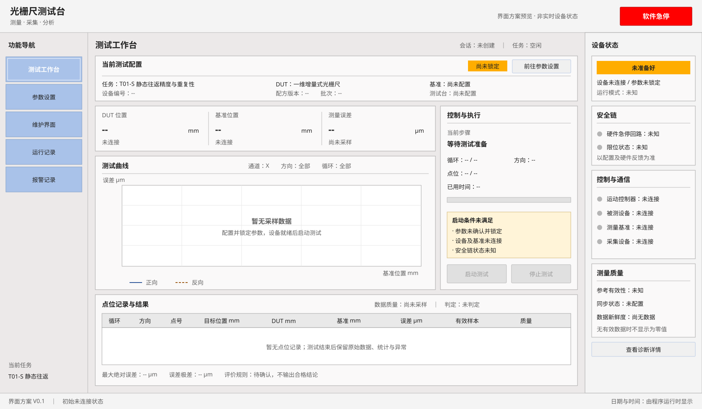

# 光栅尺测试台 · 界面方案

版本：V0.1 ｜ 日期：2026-11-09 ｜ 阶段：界面设计，待业务与硬件评审

后续落地：已创建 [WPF 工程](GratingRuler.sln)，当前实现及未接入功能见 [README](README.md)。下文和 SVG 保留为设计基线；实际界面已简化文案和装饰，右栏宽度调整为 260 DIP。

## 1. 依据与设计边界

- [工控机 UI 风格规范](工控机UI风格规范.md)：布局、配色、字体、控件外观与五个导航入口。
- [测试任务详细设计](光栅尺测试平台_测试任务设计.md)：任务、设备适用性、采集机制、状态与异常。
- [WPF XAML 可读性代码规范](WPF_XAML_AI_可读性代码规范.md)：布局容器、文件职责、绑定、命令与实现约束。

当前工作区仅有上述三份文档，没有源码、WPF 工程、目标 .NET 版本或已安装控件库。风格规范中提到的 `code/src/view`、ACS、parameters.json 和“高速涡流测试台”属于参考项目背景，不能视为本项目已经存在的实现。本方案采用其视觉与布局基线，项目名称统一为 **光栅尺测试台**；具体控制器、传感器、温度通道按后续设备配置显示，不预设品牌或通道数量。

本次交付为界面方案与静态首页预览，不包含可执行 WPF 程序、设备通信或硬件动作。文中的 ViewModel、命令和文件名均为后续实现建议。

## 2. 整体界面



预览展示“未准备好、设备未连接”的初始状态。空白曲线、灰色指示灯与禁用启动按钮是有意设计，图中不包含实测数据。

```text
主窗口 Grid：三行（78 / * / 38），业务行三列（210 / * / 280，右栏宽为建议值）。
顶部 Grid：项目名称、项目说明、右侧软件急停。
左侧 ItemsControl：五个互斥导航按钮。
中央 ContentControl：按当前导航显示独立页面。
工作台 Grid：标题、配方摘要、测量与执行区、结果表。
右侧 UserControl：机器状态、模式、安全链、通信、测量质量。
底部 Grid：左侧版本，右侧日期时间。
```

| 区域 | 内容与位置 | 尺寸/行为 |
| --- | --- | --- |
| 顶栏 | 左侧“光栅尺测试台”，副标题“测量 · 采集 · 分析”；右侧“软件急停” | 高 78 DIP；急停不随页面切换消失 |
| 导航 | 测试工作台、参数设置、维护界面、运行记录、报警记录 | 宽 210 DIP，按钮高 60 DIP；默认测试工作台 |
| 业务区 | 页面标题、表单/图表、操作、结果 | 外边距横 18、纵 14 DIP，间距 12 DIP |
| 设备状态 | 机器状态及原因、自动/维修模式、安全链、连接、数据质量 | 建议宽 280 DIP；内容过长可局部滚动 |
| 底栏 | 软件版本、日期时间 | 高 38 DIP；不放启动/停止按钮 |

初始窗口 1680 × 980 DIP，最小 1366 × 768 DIP。这里将参考尺寸作为 WPF 逻辑尺寸设计值，不等同于物理屏幕像素。主区自适应；最小尺寸下优先保留执行按钮、状态与标题，结果表内部滚动。参数页使用局部纵向滚动；DataGrid 不放进外层无限高度的 ScrollViewer。系统 DPI 为 125%/150% 时需验证实际可用工作区，不采用整页 Viewbox 缩小文字。

## 3. 视觉规范

| 资源建议名称 | 值 | 用途 |
| --- | --- | --- |
| WindowBackgroundBrush | #F4F4F4 | 顶栏、底栏、窗口 |
| WorkspaceBackgroundBrush | #ECE9E9 | 工作区及侧栏 |
| PanelBackgroundBrush | #FAF9F9 | 白灰分组 |
| InputBackgroundBrush | #FFFFFF | 表单、曲线、表格 |
| PanelBorderBrush | #A6A6A6 | 1 DIP 面板边线 |
| NavigationBackgroundBrush | #A9C2E9 | 浅蓝导航 |
| NavigationBorderBrush | #829FC8 | 导航边线 |
| TabBackgroundBrush | #1D1978 | 报警页等确有页签的区域 |
| TextBrush / SecondaryTextBrush | #202020 / #606060 | 正文、辅助文字 |
| StartBrush / FaultBrush | #91C493 / #FF0000 | 启动、停止及故障 |
| ReadyBrush / WarningBrush / UnknownBrush | #2DCC2D / #FFAD00 / #B5B5B5 | 就绪、警告、未知 |

中文使用 Microsoft YaHei UI，回退 Microsoft YaHei；默认正文 14 DIP、常规字重；软件标题 22 DIP、页面标题 20 DIP、关键数值 22 DIP，标题适量半粗体。数值右对齐并独立显示单位。面板直角，按钮仅 2～3 DIP 小圆角；不用大圆角卡片、渐变背景或大阴影。

导航选中项采用白字和白色内边线，并通过选中标记和可访问性名称强化识别。普通按钮高 34 DIP，执行按钮高 44 DIP，输入框高 32 DIP，表格行高 32 DIP。按钮覆盖悬停、按下、焦点和禁用状态；禁用采用灰底灰字。每个状态灯旁必须有文字；红色停止与软件急停采用白色加粗文字。

## 4. 测试工作台

### 4.1 页面布局

1. **标题行**：测试工作台、当前会话标识、任务状态；尚未创建会话显示“会话：未创建”。
2. **配方摘要**：任务编号及名称、DUT 类型/编号、测试台、基准、配方版本、锁定状态。“前往参数设置”仅负责导航。
3. **主区左侧**：DUT 值、基准值、误差及质量；下方为曲线，提供通道、方向、循环筛选及图例。
4. **主区右侧控制与执行**：当前步骤、循环、方向、点位或事件进度、已用时间、启动阻断原因；底部固定“启动测试 / 停止测试”。
5. **下部结果区**：原始点位/事件列表与统计摘要。数据质量、任务结束状态、产品判定分别显示。

未采样时测量值为“--”，曲线内显示“暂无采样数据”，表格显示空态说明；不得绘制虚构曲线或用 0 代替断连值。二维对象增加 X/Y 通道选择或并排读数，不能压成单一位置字段。

### 4.2 各任务呈现

| 任务 | 曲线/主视图 | 进度重点 | 结果重点 |
| --- | --- | --- | --- |
| T01-S 静态往返 | 横轴基准位置 mm，纵轴误差 μm；方向用颜色和线型区分 | 循环、方向、点位、到位/稳定/采样 | 点位误差、最大绝对误差、极差；重复性算法待确认 |
| T01-D 动态往返 | 对齐后的误差—位置曲线，原始序列可追溯 | 运动与捕获状态并列；事件接收、匹配、缺失数量 | 动态误差、丢触发统计、同步质量；未对齐不显示精度结论 |
| T02 Z 相重复性 | 横轴循环序号，纵轴锁存基准位置 mm | 方向、目标窗口、有效/缺失/多触发 | 正反向位置极差、均值、均值差 |
| T03 单向静态 | 单方向误差—位置曲线 | 点位、稳定、有效样本 | 点位误差表与质量；可选回起点不计入采样 |
| T04 静态噪声 | 横轴时间 s，纵轴相应通道测量量；分状态序列 | 当前状态阶段、采样时长 | 峰峰值、标准差、RMS、均值漂移；不能把无效测量当作噪声 |
| T05 速度与加速度 | 时间—速度、时间—加速度分图，明确各自单位 | 加速、匀速、减速实际阶段 | 分阶段误差；标注直接输出/位置导数及算法来源 |
| T06 动态 Rz | 候选 X/Y 误差与实际 Rz 角度视图 | 展示“方案待确认”，不开放执行 | 坐标变换、联动和公式确认后实施 |
| T07 IO 边沿重复性 | 循环—锁存基准位置散点及事件表 | 方向、电气边沿、物理边界、重触发状态 | 分组极差、均值、漏触发、多触发及边界差 |

位置统一转换和零点关系有效后，才可计算 `DUT - Reference`。非位移传感器保留其实际工程单位；不因采用本界面而强制换算成 mm。

### 4.3 结果表字段

- 静态点位：循环、方向、点号、目标位置、DUT 工程值、基准值、误差、有效样本数、质量、时间。
- 连续采集：序号、时间源/时间戳、通道、触发 ID、DUT 值、基准值、配对状态、质量；原始数据通过会话详情追溯。
- 边沿事件：循环、方向、边沿、物理边界 ID（IO）、触发序号、锁存基准位置、时间、有效性、异常原因。
- 所有表格的列头带单位；原始量、工程量和显示小数位分离。无效行保留并标识，不静默删除。

## 5. 参数设置

采用页面标题、双列表单分组、底部固定操作栏。顶层不额外增加导航页签；任务改变时更换专用字段区域。

| 参数组 | 主要字段 | 联动/校验 |
| --- | --- | --- |
| 测试对象与任务 | 对象类型、设备 ID、通道、测试台类型、任务编号、配方名称/版本、批次 | 按业务文档第 2.2 节矩阵及实际设备能力过滤任务 |
| 基准与坐标 | 干涉仪/轴反馈、来源通道、单位、坐标偏置、参考独立性 | 轴反馈与 DUT 同源时不能作为独立精度基准 |
| 运动与姿态 | 测试轴、起止位置、速度、加减速度、方向；Z/Rx/Ry/Rz 按设备启用 | 单位、范围、软限位、速度限制来自实际配置 |
| 静态采样 | 点位列表或间隔、稳定时间、每点有效样本数、往返次数 | 点位列表与间隔明确互斥；展示生成的点位数量 |
| 动态采集 | 采样率、触发源/间隔/窗口/方向、同步机制、参考锁存方式、缓冲配置 | 硬件同步能力未确认时显示阻断原因 |
| Z 相 / IO | 通道、极性、有效边沿、位置窗口、允许缺失/多触发策略 | IO 电气边沿与物理边界分别设置，不能混为一项 |
| 噪声 / 高速 | 状态阶段、持续时间；高速台、滤波/差分、时延补偿 | 噪声状态切换未确定前禁用对应动作；高速需能力验证 |
| 数据质量与评价 | 无效数据策略、有限重试策略、统计方法、限值及版本 | 不提供臆造默认限值；无最终规则显示“未判定” |

操作栏为“保存草稿 / 恢复已保存值 / 确认并锁定”。保存不等于锁定；校验错误在字段旁显示，并在顶部汇总首个错误。确认后工作台显示配方摘要及锁定状态；运行中不可修改本次配方。非运行状态可“解除锁定并编辑”，修改后须重新校验锁定。每次会话保存配方快照，后续编辑不能改变历史记录。

适用性不能仅按任务名称判断：绝对式禁用 T02；IO 仅提供 T07；二维 Z 相和高速任务取决于输出能力；“参照”任务须验证物理量与采集条件；T06、名称未确认的“激光工具胶”显示待确认说明。具体对象与任务资格以业务文档矩阵为准。

## 6. 维护界面

上部显示设备连接和诊断，中部显示轴状态/位置，下部为运动操作与约束。设备名称由配置提供；DUT、基准、控制器、采集设备分别显示连接及质量，不能把“已连接”当成“测量有效”。

- 连接区：设备、接口摘要、连接状态、最近错误、连接/断开。
- 轴区：轴选择、实际位置、使能、回零状态（如硬件支持）、正负限位、故障原因。
- PTP 区：目标位置、速度、加减速度、执行定位、停止；输入值校验反馈就地显示。
- JOG 区：负向/正向按住运行，释放停止；松键、丢失鼠标捕获、页面隐藏、窗口失焦都必须有停止请求路径。不得做成点击后持续运动的开关。
- 约束区：维修模式、任务占用、限位、命令执行反馈。任务运行时拒绝冲突的手动动作；服务层再次执行状态校验。

模式切换显示请求与反馈，不能点击后直接把实际模式显示为已切换。断开、使能和复位的允许条件由设备服务定义；复位不自动重新启动测试。未确定的供电动作不添加可执行按钮。

## 7. 运行记录

导航名称保留“运行记录”，页面标题为“实验记录”。顶部为日期范围、任务类型、设备/批次关键词、结束状态筛选及查询；中部为虚拟化 DataGrid；底部显示选中项与导出进度。

列表列：会话 ID、起止时间、批次、DUT、任务、配方版本、结束状态、数据质量、判定、原始数据保存状态。

选中后打开会话详情，查看配方快照、设备与基准、坐标与同步配置、曲线、统计、原始数据索引和异常记录。提供“导出所选记录”，具体文件格式在实现阶段确定；导出显示目标、进度、成功/失败原因。部分数据、终止和故障会话也可追溯，不能仅保留成功结果。

## 8. 报警记录

深蓝页签“当前报警 / 历史报警”；顶部为等级与来源筛选。表格列为发生时间、等级、来源、代码、内容、关联会话/步骤、活动状态、确认状态、确认人、确认时间；历史增加恢复时间（有反馈时）。

操作区为确认人输入及“确认所选报警”；确认不改变设备实际故障状态，也不自动解除启动限制。断连、数据过期、同步失败等说明必须给出具体来源和诊断原因。长说明可展开，不能只显示一盏红灯。

## 9. 右侧设备状态与操作反馈

自上而下显示：

1. 机器状态：未准备好 / 空闲 / 运行中 / 故障，以及最重要的阻断原因。
2. 运行模式：自动 / 维修 / 未知，以设备服务反馈为准。
3. 安全链：硬件急停回路、限位等已配置安全项；未知必须灰色显示。
4. 控制与通信：运动控制器、DUT、基准、采集设备，分别显示连接状态。
5. 测量质量：参考有效性、同步状态、数据新鲜度；温度仅在存在实际通道时展示，含单位。

点击有诊断入口的状态项打开详情。状态面板不承担采集算法或安全判断，只展示服务状态。软件急停始终在顶栏可见，不增加前置确认；显示“已发送/设备已反馈/发送失败”等真实结果，不能把按钮点击当作硬件已停止。实际安全保护由电气安全回路承担。

## 10. 状态与启用规则

| 状态 | 启动 | 停止 | 参数与反馈 |
| --- | --- | --- | --- |
| 未准备好 | 禁用，列出原因 | 按服务能力 | 可编辑；缺设备、配置未锁定、同步未确认分别提示 |
| Idle / 空闲且就绪 | 配方锁定、设备和安全条件满足后可用 | 无活动任务时禁用 | 可以先解锁编辑，解锁后启动禁用 |
| Preparing / 准备中 | 禁用 | 提交终止请求 | 锁定，显示配置/移动/捕获准备步骤 |
| Running / 运行中 | 禁用 | 请求受控停止 | 锁定，显示采集、运动和进度 |
| Finalizing / 收尾中 | 禁用 | 显示已有停止/收尾请求，避免重复提交 | 显示排空缓存、保存、清理；未知总量不伪造百分比 |
| Completed / 已完成 | 再次检查条件后可新建会话 | 无活动任务时禁用 | 完成不等于合格；展示统计和保存结果 |
| Terminated / 已终止 | 安全收尾完成并重新就绪后可用 | 按实际设备状态 | 保留部分数据和停止原因 |
| Fault / 故障 | 禁用 | 根据服务可用性允许停止请求 | 展示故障、异常步骤、已采数据；确认报警不能恢复就绪 |

机器状态与任务状态是两个独立字段，例如“任务已终止 / 机器故障”可同时存在。最终判定分“合格 / 不合格 / 未判定”；未定义规则或数据无效时必须为未判定，并显示原因。数据质量另列有效/不完整/无效，不以任务 Completed 推导合格。

不新增暂停/继续。所有指令都显示执行中、成功、拒绝或失败；UI 的禁用状态仅用于交互，不能替代业务层联锁。长时间设备访问、导出及分析不阻塞 UI 线程。

## 11. WPF 实现映射（后续落地建议）

### 11.1 文件职责

```text
Views/MainWindow.xaml                  窗口骨架、导航、页切换、底栏
Views/Controls/DeviceStatusPanel.xaml   常驻设备状态与诊断入口
Views/Pages/TestWorkbenchView.xaml     当前任务、曲线、执行与结果
Views/Pages/ParametersView.xaml        通用及任务专用参数、锁定
Views/Pages/MaintenanceView.xaml       连接诊断、PTP、JOG
Views/Pages/RunRecordsView.xaml        查询、详情、导出
Views/Pages/AlarmRecordsView.xaml      当前/历史、确认
Resources/Colors.xaml                  颜色资源
Resources/ControlStyles.xaml           字体、按钮、输入、表格、导航样式
ViewModels/                            按上述页面职责配置，避免提前拆分大量类
```

上述文件本次未创建。目标 .NET、部署系统、MVVM 框架及绘图方案需在实际建工程时确认；本方案不引入 NuGet 依赖。曲线不能用静态图片代替正式采样绘图。

### 11.2 核心绑定契约

| 区域 | 建议属性 | 建议命令 |
| --- | --- | --- |
| 主窗口 | CurrentPage、NavigationItems、VersionText、ClockText | NavigateCommand、EmergencyStopCommand |
| 工作台 | SessionIdText、TaskStatusText、RecipeSummary、IsRecipeLocked、DutValueText、ReferenceValueText、ErrorText、CurrentStepText、ProgressText、StartBlockReason、PointRecords、TriggerEvents、ResultStatusText、DataQualityText | StartCommand、StopCommand、OpenParametersCommand |
| 参数 | SelectedDutType、AvailableTasks、SelectedTask、RecipeDraft、ValidationSummary、IsLocked | SaveDraftCommand、RestoreSavedCommand、ConfirmAndLockCommand、UnlockCommand |
| 维护 | Devices、SelectedAxis、AxisPositionText、MotionSettings、OperationFeedback | ConnectCommand、DisconnectCommand、EnableCommand、MoveToCommand、StopMotionCommand、JogStartCommand、JogStopCommand |
| 记录 | Filters、Sessions、SelectedSession、ExportProgressText | QueryCommand、OpenSessionCommand、ExportCommand |
| 报警 | CurrentAlarms、HistoryAlarms、SelectedAlarms、AcknowledgedBy | QueryCommand、AcknowledgeCommand |
| 设备状态 | MachineStatusText、MachineReason、ModeText、SafetyItems、ConnectionItems、MeasurementQualityItems | OpenDiagnosticsCommand |

这些名称是接口建议，尚无实现。DataContext 在应用组合入口创建并明确传入，UserControl 继承上下文。读数用 OneWay；编辑项用明确的 TwoWay 和更新策略。显示文本显式区分未采样、无效、过期与真实零值，单位不藏在格式化规则里。

操作绑定 ICommand，CanExecute 反映可用性；JOG 的按下/释放/失焦由轻量视图事件适配到命令，适配层不访问 SDK。后台集合通知切回 Dispatcher；高频采样聚合刷新，实际刷新频率按性能要求决定。

XAML 采用 4 空格缩进，多属性分行；主布局先声明行列，按视觉顺序编排区域。使用 Border.Padding、控件 Margin，不使用不存在的 Grid.Padding、Grid.RowSpacing、StackPanel.Spacing 或 Button.CornerRadius。需要按钮圆角时通过共享模板实现。跨页样式用语义资源键与 StaticResource；局部简单样式就近定义。

关键控件提供 AutomationProperties.Name，表单 Label 关联输入，键盘焦点可见；不为运动启动绑定容易误触的全局快捷键。图表图例同时使用文字、颜色与线型。

## 12. 评审与验证

本次已按三份文档核对导航、任务编号、状态语义、颜色、数据空态及 WPF 实现约束。SVG 是静态设计图，不能验证真实 WPF 测量布局、绑定、键盘行为或设备反馈；本次未编译、未运行程序、未连接设备。

后续实现应覆盖：1366×768 与 1680×980、100%/125%/150% DPI；长中文、空数据、真实零值、过期数据、二维通道；任务适用性、参数锁定、拒绝启动原因；停止到收尾、故障、导出失败；JOG 释放与失焦；表格虚拟化和后台通知线程。

仍须沿用业务文档的待确认项：动态触发与锁存链路、基准独立性、设备接口和性能、评价公式/阈值、噪声测试状态切换、二维 Rz 坐标与联动、IO 物理边界语义及“激光工具胶”正式名称。它们不妨碍评审页面布局，但不能据此启用未确认的硬件动作或生成合格结论。
