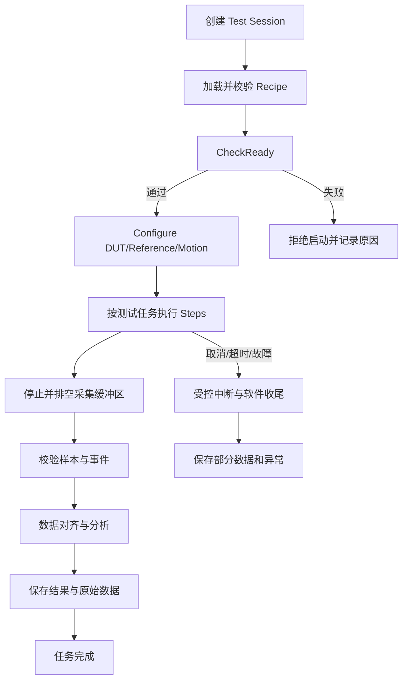

# 光栅尺综合测试平台——测试任务详细设计

> 文档类型：软件业务设计 / 测试任务设计  
> 版本：V0.1（依据客户讨论记录整理，待技术评审）  
> 适用范围：增量式光栅尺（一维、二维）、绝对式光栅尺、激光工具胶（名称待确认）、模拟量传感器、IO 传感器  
> 说明：本文将**客户已明确需求**与**建议的软件实现方案**分开描述。标注 **【待确认】** 的内容不得直接作为最终验收要求。

---

## 1. 目标与设计原则

### 1.1 设计目标

把客户提出的测试方案转换成可供上位机执行的**测试任务（Test Task）**。每个任务应明确：

1. 适用的被测对象和测试台类型；
2. 前置条件与配置参数；
3. 按顺序执行的动作（Action）；
4. 每个动作的完成条件及事件响应；
5. 数据何时采集、如何与测量基准对应；
6. 计算的指标、保存的原始数据与输出结果；
7. 超时、无效测量、缺少触发等异常处理。

### 1.2 关键术语

| 术语 | 定义 |
|---|---|
| DUT | Device Under Test，被测设备 |
| Reference | 测量基准：激光干涉仪或运动轴反馈 |
| Recipe | 测试配方：参数集合，包含运动、采集、姿态、分析参数 |
| TestTask | 一项完整的测试，如静态往返、Z 相重复性 |
| Step | 测试步骤，如移动起点、准备采集、正向运动 |
| Action | 可复用执行动作，如 MoveTo、CapturePoint、ArmTrigger |
| Trigger Event | 触发事件，包含触发源、方向/边沿、序号、关联时间与位置 |
| Test Session | 一次测试运行实例，负责关联配方、设备、原始数据、结果和异常 |

### 1.3 测试设计边界

- 同一测试任务可以适用于不同被测对象，但设备初始化、采集接口、数据单位和分析算法可能不同。
- 动态测试中，**运动和数据采集并行执行**，不能将每次触发设计成等待上位机同步读取的阻塞动作。
- 精度比较必须明确被测值与基准值的时间/事件对齐方式。仅凭上位机读取顺序不能保证高精度同步。
- **不能默认运动轴反馈与 DUT 相互独立**。若轴反馈就是 DUT 信号，不能把它当作独立精度基准。
- 电气安全回路承担实际安全保护。软件检测安全故障后禁止新任务、标记 Fault 并执行允许的软件收尾；不以软件替代硬件安全回路。
- 客户未给出具体指标公式与合格阈值时，先输出可核验的原始统计量，最终判定逻辑标记为【待确认】。

---

## 2. 测试对象与任务矩阵

### 2.1 测试任务编号

| 编号 | 任务名称 | 简称 | 采集方式 |
|---|---|---|---|
| T01-S | 静态往返精度与重复性测试 | RoundTripStatic | 到位、稳定、点位采集 |
| T01-D | 动态往返精度与重复性测试 | RoundTripDynamic | 连续运动、位置触发/同步采样 |
| T02 | Z 相零位重复性测试 | ZeroRepeatability | Z 相边沿捕获、参考位置锁存 |
| T03 | 单向静态测量 | Unidirectional | 单向逐点到位采集 |
| T04 | 静态噪声测试 | StaticNoise | 固定位置、持续采集、状态对比 |
| T05 | 速度与加速度测试 | VelocityAcceleration | 高速运动、连续同步采集 |
| T06 | 动态 Rz 测试 | DynamicRz | 二维测量、多轴联动同步采集 |
| T07 | IO 边沿位置重复性测试 | IOEdgeRepeatability | 上升沿/下降沿捕获、参考位置锁存 |

### 2.2 适用关系

| 测试对象 | T01-S | T01-D | T02 | T03 | T04 | T05 | T06 | T07 |
|---|---|---|---|---|---|---|---|---|
| 一维增量式光栅尺 | ✓ | ✓ | ✓ | ✓ | ✓ | 高速台 | — | — |
| 二维增量式光栅尺 | ✓ | ✓ | ✓* | ✓ | ✓ | 高速台* | 待定 | — |
| 绝对式光栅尺 | 参照 | 参照 | — | 参照 | 参照 | 待确认 | — | — |
| 激光工具胶（名称待确认） | 参照 | 待确认 | — | 参照 | 参照 | 待确认 | — | — |
| 模拟量传感器 | 参照 | 参照 | — | 参照 | 参照 | 待确认 | — | — |
| IO 传感器 | — | — | — | — | — | — | — | ✓ |

> ✓：客户明确要求或直接包含在增量式方案；“参照”：客户提出参照增量式方案，具体适用条件尚待确认；`*`：取决于二维光栅尺是否提供 Z 相以及高速输出。IO 的主要独立测试任务是 T07。

---

## 3. 通用配方与动作库

### 3.1 通用配置

| 参数组 | 配置项 | 说明 |
|---|---|---|
| 被测设备 | 类型、设备 ID、通道、通信参数、单位/分辨率 | 按设备驱动决定 |
| 基准 | 干涉仪 / 轴反馈、轴和通道、坐标系、单位 | 需要独立有效性检查 |
| 运动 | 测试轴、起止位置、速度、加速度、减速度、运动方向 | 所有涉及运动的测试使用 |
| 姿态 | Z、Rx、Ry、Rz | 按机械配置和测试内容启用 |
| 测量 | 位置点列表 / 间隔、采样率、稳定时间、样本数 | 视任务启用 |
| 触发 | 来源、通道、有效边沿、方向、位置窗口、触发间隔 | 动态、Z 相、IO 使用 |
| 循环 | 次数、正反向控制、失败后重试策略 | 不允许无限重试 |
| 数据 | 时间源、同步机制、缓冲区长度、质量判定 | 根据硬件能力配置 |
| 评价 | 分析方法、限值、合格规则 | 【待客户确认】 |

### 3.2 通用动作定义

| Action | 功能 | 正常完成条件 |
|---|---|---|
| `CheckReady` | 检查安全、轴、DUT、基准、配置 | 全部满足启动条件 |
| `ConfigureDUT` | 配置 DUT 模式、单位、量程、采样 | 硬件确认或读回验证 |
| `ConfigureReference` | 配置基准设备及坐标关系 | 基准就绪 |
| `ConfigureMotion` | 设置速度、加速度、减速度、轨迹 | 参数通过校验 |
| `MoveTo(position)` | 定位至指定点 | 运动结束并到位 |
| `WaitStable` | 等待运动/测量稳定 | 稳定时间或波动阈值满足 |
| `ArmCapture` | 清空缓存并使能触发/采样捕获 | 接收端确认就绪 |
| `StartCapture` | 启动连续采集 | 采集状态为运行中 |
| `CapturePoint` | 获取点位的 K 个有效样本 | DUT 和基准样本有效 |
| `ExecuteTrajectory` | 运动控制器执行连续轨迹 | 收到运动完成结果 |
| `RecordTriggerEvent` | 异步记录硬件触发事件 | 事件数据入队并关联 |
| `StopAndDrainCapture` | 停止采集并读取剩余缓冲数据 | 全部有效缓存已处理 |
| `ValidateSamples` | 检查样本数量、质量、同步关系 | 满足分析条件 |
| `AlignSamples` | 将 DUT 与基准按事件或时间匹配 | 得到有效数据配对 |
| `Analyze` | 计算指定评价指标 | 形成结果与质量信息 |
| `Persist` | 保存配方、原始数据、统计和异常 | 存储完成 |
| `Finalize` | 清理任务资源和收尾 | 设备/任务处于允许的结束状态 |

> `RecordTriggerEvent` 是在轨迹运行期间异步到达的处理动作，而不是运动必须等待的串行 Step。

### 3.3 所有任务通用的生命周期



---

## 4. T01-S 静态往返精度与重复性测试

### 4.1 适用对象

- 一维、二维增量式光栅尺；
- 绝对式光栅尺（参照）；
- 激光工具胶（参照，设备名称及输出含义待确认）；
- 模拟量传感器（需将模拟量转换成与运动位置可比较的工程量）。

### 4.2 测试目的

在预设位置正向和反向反复测量，比较 DUT 与基准读数，分析沿行程的误差、重复性及正反向差异。

### 4.3 专用参数

测量起点 `startPos`、终点 `endPos`、点位列表 `points[]` 或点位间隔 `spacing`、往返次数 `cycleCount`、每点样本数 `samplesPerPoint`、稳定等待时间 `settleTime`、运动方向、是否记录端点重复采样、误差评价规则。

### 4.4 动作顺序

| Step | Action | 执行内容 | 完成/转移条件 |
|---|---|---|---|
| S01 | `CheckReady` | 校验设备、位置软限位、参数与安全状态 | 就绪 |
| S02 | `ConfigureDUT/Reference/Motion` | 配置采集、参考与运动参数 | 三者就绪 |
| S03 | `GeneratePoints` | 按起止点/间隔生成点位序列 | 点位有效、非空 |
| S04 | `EstablishCoordinates` | 读取并记录零点偏置、坐标系关系 | 转换关系明确 |
| S05 | `MoveTo(startPos)` | 移动至首个测量位置 | 运动到位 |
| S06 | `SetCycleIndex(1)` | 开始第 1 次循环 | 已设置 |
| S07 | `ScanForward` | 依次执行 `MoveTo(Pi) → WaitStable → CapturePoint → SavePoint` | 正向点位全部完成 |
| S08 | `ScanBackward` | 反向按点位执行同样的测量动作 | 反向点位全部完成 |
| S09 | `CheckCycleCount` | 判断是否达到往返次数 | 否：回到 S07；是：S10 |
| S10 | `ValidateSamples` | 校验每点有效样本数量和测量质量 | 校验结束 |
| S11 | `Analyze` | 误差、同方向/双方向重复性、正反向差异 | 分析完成 |
| S12 | `Persist/Finalize` | 保存并结束任务 | 保存完成 |

**每点的内部执行顺序：**

```text
MoveTo(Pi)
  → WaitAxisInPosition
  → WaitStable
  → Capture K valid DUT/reference samples
  → Pair samples by defined reference rule
  → Save PointRecord(cycle, direction, pointIndex, target, dut, reference, quality)
```

### 4.5 数据与输出

- 原始：周期号、点位编号、方向、目标位置、DUT 原始值与工程值、参考值、采集时间、质量标志。
- 分析：每点误差、最大绝对误差、误差极差、正反向位置差、重复性统计。
- 示例误差：`e = X_DUT - X_REF`，**必须先完成坐标与零点一致性处理**。
- 精度、重复性的最终统计定义与合格阈值【待客户确认】。

### 4.6 异常处理

未到位、稳定失败、任一点无有效读数、参考设备无效、点位超限时记录具体步骤和点位；策略可选择终止或标记本点失败后继续，需在 Recipe 中明确。

---

## 5. T01-D 动态往返精度与重复性测试

### 5.1 适用对象与核心区别

适用于支持动态输出并具备可行同步方案的连续测量型 DUT。与 T01-S 不同，运动轴**不停在测量点**，数据由位置触发、公共触发或连续同步采样获取。

客户当前提出“按被测物位置产生采集触发”，因此应优先验证 **DUT 位置触发 → 参考位置捕获** 的硬件链路。

### 5.2 专用参数

轨迹起止位置、运动速度/加速度/减速度、往返次数、触发源、触发位置列表或间隔、触发方向、触发窗口、采样率（适用时）、允许丢触发数、同步方式、参考锁存方式。

### 5.3 动作顺序

| Step | Action | 执行内容 | 完成/转移条件 |
|---|---|---|---|
| S01 | `CheckReady` | 校验 DUT、运动轴和参考设备 | 就绪 |
| S02 | `ConfigureDUT/Reference` | 设置动态采样、触发和数据通道 | 就绪 |
| S03 | `ConfigureMotion` | 生成正向/反向轨迹 | 轨迹有效 |
| S04 | `ConfigureTrigger` | 确认 DUT 触发源、事件编号与基准捕获机制 | 硬件链路配置完成 |
| S05 | `MoveTo(startPos)` | 移动到起点 | 到位 |
| S06 | `ArmCapture` | 准备采集与事件缓冲 | 捕获端确认就绪 |
| S07 | `StartCapture` | 开启连续采集/事件捕获 | 采集运行 |
| S08 | `ExecuteForwardTrajectory` | 连续正向运动；期间异步记录触发及数据 | 正向运动完成，缓存可读取 |
| S09 | `ExecuteBackwardTrajectory` | 连续反向运动；期间异步记录触发及数据 | 反向运动完成，缓存可读取 |
| S10 | `CheckCycleCount` | 未达到次数则重复 S08～S09 | 达到次数 |
| S11 | `StopAndDrainCapture` | 停止并排空数据缓冲 | 数据收齐 |
| S12 | `ValidateSamples/AlignSamples` | 按触发 ID 或可信时间戳匹配 DUT/基准 | 匹配完成 |
| S13 | `Analyze` | 动态位置误差、重复性、丢触发和异常统计 | 完成 |
| S14 | `Persist/Finalize` | 保存结果、原始波形及触发事件 | 完成 |

**重要：** 运动和捕获在 S08/S09 并行。接收触发事件不应阻塞运动。对于无法直接同步的硬件，应明确插值、时延校准的适用性和不确定度，不得假定软件读取时刻相等就是同一测量时刻。

### 5.4 输出

每次事件的 `triggerId / cycle / direction / dutPosition / referencePosition / timestamp / quality`，以及动态误差分布、重复性和丢触发率。

### 5.5 异常

参考锁存失败、触发数量异常、缓冲溢出、时钟不同步、数据无效、运动中途停止；均需保留已采集数据与明确的有效性结论。

---

## 6. T02 增量式光栅尺 Z 相零位重复性测试

### 6.1 适用对象

具有可捕获 Z 相信号的一维或二维增量式光栅尺。绝对式光栅尺不执行此任务。

### 6.2 测试目的

多次经过同一个 Z 相标记，记录**触发瞬间的基准位置**，计算正向、反向触发位置重复性及两方向差异。

### 6.3 专用参数

零位搜索范围、起止位置、正反向速度、加速度、重复次数、Z 相物理输入通道、有效边沿、有效位置窗口、参考捕获源及允许的缺失/多触发策略。

### 6.4 动作顺序

| Step | Action | 执行内容 | 完成条件 |
|---|---|---|---|
| S01 | `CheckReady` | 检查 Z 相输入、运动轴、参考通道 | 就绪 |
| S02 | `ConfigureEdgeCapture` | 配置 Z 相有效边沿和参考位置锁存 | 配置成功 |
| S03 | `MoveTo(startSide)` | 移至零位一侧，确认初始状态 | 到位 |
| S04 | `ClearEvents/ArmCapture` | 清除历史事件并使能捕获 | 捕获就绪 |
| S05 | `MoveForwardAcrossZero` | 正向穿越零位 | 运动段完成 |
| S06 | `ValidateForwardEvents` | 查找对应区间内有效 Z 相事件 | 事件被记录/缺失被标记 |
| S07 | `MoveBackwardAcrossZero` | 反向穿越零位 | 运动段完成 |
| S08 | `ValidateBackwardEvents` | 查找对应区间内有效 Z 相事件 | 事件被记录/缺失被标记 |
| S09 | `CheckRepeatCount` | 达到次数则结束，否则重复 S05 | 达标 |
| S10 | `StopAndDrainCapture` | 停止捕获、读取最后事件 | 完成 |
| S11 | `Analyze` | 按方向分别计算触发位置统计 | 完成 |
| S12 | `Persist/Finalize` | 保存事件与结果 | 完成 |

### 6.5 数据与结果

- 事件：`cycleIndex、direction、edge、latchedReferencePosition、timestamp、validity`。
- 每方向触发位置极差 `R = max(P_i) - min(P_i)`，平均触发位置、正反向均值差。
- 具体重复性标准与是否允许重试【待确认】。

### 6.6 特别要求

Z 相采集应优先使用硬件边沿锁存。若位置仅在上位机收到消息后读取，则其误差受通信/调度延迟影响，不能默认满足精密零位测试要求。若每行程可能经过多个 Z 相，应使用位置窗口和事件序号筛选目标标记。

---

## 7. T03 单向静态测量

### 7.1 适用对象

增量式、绝对式以及能输出可比较工程量的其他连续测量型 DUT。

### 7.2 测试目的

沿固定方向完成**一次**点位扫描，得到每个测量位置的 DUT/基准差值。不将返回起点的运动自动作为第二次测量。

### 7.3 参数

起始位置、终止位置、点位间隔/列表、运动速度/加速度/减速度、稳定时间、每点采样数、测量方向、参考源、姿态。

### 7.4 动作顺序

1. `CheckReady`：校验设备、基准、行程与配置。
2. `ConfigureDUT/Reference/Motion`：初始化测试。
3. `GeneratePoints`：生成单向有序点位序列。
4. `MoveTo(firstPoint)`：移动到首点。
5. 对每个点执行 `MoveTo(Pi) → WaitStable → CapturePoint → SavePointRecord`。
6. `ValidateSamples`：校验所有点位质量。
7. `Analyze`：计算各点误差、最大绝对误差及分布。
8. `Persist/Finalize`：保存并完成任务；如需回起点，应作为**不采样的可选收尾动作**。

### 7.5 输出与异常

输出点位误差表、误差曲线、测量质量状态。未到位/测量无效按配置中止或标记失败，不能以最近一次旧读数充当本点数据。

---

## 8. T04 静态噪声测试

### 8.1 适用对象

增量式、绝对式及可连续读取的其他测量型传感器。模拟量传感器需同时记录原始模拟量与换算后的工程量。

### 8.2 测试目的

在固定位置持续采集 DUT 和参考数据，比较正常状态与客户定义的另一供电/使能状态下的测量波动。

### 8.3 参数

固定位置、姿态、采样率、采集时长、稳定时间、采集通道、供电/使能状态序列、允许的状态切换操作、分析指标。

### 8.4 动作顺序

| 阶段 | Step | Action | 执行内容 |
|---|---|---|---|
| 准备 | S01 | `CheckReady/Configure` | 校验设备及采样配置 |
| 定位 | S02 | `MoveTo(fixedPos)` | 移动至固定测量点 |
| 稳定 | S03 | `WaitStable` | 等待到位及稳定 |
| 正常采样 | S04 | `StartCapture` | 在正常工作状态连续采集指定时长 |
| 正常结束 | S05 | `StopAndDrainCapture` | 保存第一阶段原始序列 |
| 状态转换 | S06 | `SetAllowedPowerOrEnableState` | 按安全许可切换至指定状态 |
| 状态确认 | S07 | `VerifyState/WaitStable` | 确认状态并等待稳定 |
| 第二阶段 | S08 | `StartCapture` | 在第二状态连续采集指定时长 |
| 第二结束 | S09 | `StopAndDrainCapture` | 保存第二阶段原始序列 |
| 分析 | S10 | `Analyze` | 各阶段波动及阶段间偏移 |
| 收尾 | S11 | `Persist/Finalize` | 保存并执行允许的恢复动作 |

### 8.5 输出

每阶段：采样时刻、DUT、基准、状态、数据质量；统计峰峰值、标准差、RMS、均值漂移及相对基准的波动。应区分 DUT 自身波动和基准/机械环境变化。

### 8.6 未决问题

**【待确认】“断电状态”到底指伺服断使能、驱动器断电、传感器断电，还是其他状态？**

- 若传感器自身断电，可能无法继续读取测量值，应改为断电前后/复电后的对比任务。
- 对垂直轴等存在失稳风险的机构，不能仅因测试流程需要而取消保持或安全保护；状态切换必须经过机械/电气安全评估。

---

## 9. T05 速度与加速度测试（高速台）

### 9.1 适用对象

客户明确提出用于高速测试台；被测传感器需支持速度、加速度输出，或客户明确认可从位置数据导出速度与加速度。其他设备默认不自动启用。

### 9.2 测试目的

在加速、匀速、减速三个阶段对比 DUT 速度/加速度与参考测量结果，评价幅值误差及动态波动。

### 9.3 参数

高速台编号、行程、目标速度、加速度、减速度、采样频率、参考源、阶段划分方式、滤波设置、时延补偿方式、重复次数。

### 9.4 动作顺序

1. 检查高速台和行程安全限制；配置 DUT 与基准高速采样。
2. 生成包含加速、匀速、减速阶段的轨迹。
3. `MoveTo(startPos)`；清零并 `ArmCapture`。
4. `StartCapture`；启动运动轨迹。
5. 运动期间连续记录 DUT/基准位置、速度、加速度及时间信息。
6. 轨迹完成后 `StopAndDrainCapture`。
7. 按参考实际运动状态划分加速段、匀速段、减速段。
8. 按统一时间/事件对齐；必要时应用经验证的滤波和延迟校正。
9. 分别分析速度误差、加速度误差、峰值及波动。
10. 保存波形、阶段区间、算法参数和分析结果。

### 9.5 重要限制

运动控制器设定速度**不等于**实际参考速度。若基准速度/加速度由位置差分获得，需记录差分及滤波方法，避免引入明显噪声和相位偏差。误差计算区间应按实际运动数据确定。

---

## 10. T06 二维增量式光栅尺动态 Rz 测试（待定）

### 10.1 适用对象与状态

仅二维增量式光栅尺；客户尚未确认协调控制方式和误差公式。本节是**候选软件执行方案**，不作为已确认交付范围。

### 10.2 测试目的

直线运动时同步执行 Rz 旋转，测量二维光栅尺 X/Y 输出相对于参考坐标变换后位置的动态误差。

### 10.3 参数

平移轴与行程、平移速度/加速度/减速度、Rz 旋转范围、角速度/角加速度、两轴同步关系、旋转中心、坐标变换、采样率、参考源和触发方式。

### 10.4 候选动作顺序

1. `CheckReady`：检查平移轴、Rz 轴、二维 DUT 的 X/Y 数据和参考来源。
2. `ConfigureCoordinates`：确定旋转中心、坐标方向、安装偏置与变换关系。
3. `ConfigureMotion`：生成平移 + Rz 的同步轨迹，验证运动范围。
4. `ConfigureDUT/Reference`：配置二维采集及参考数据。
5. `MoveTo(startPose)`：各轴运动至轨迹起始姿态。
6. `ArmCapture/StartCapture`：采集通道准备并启动。
7. `ExecuteCoordinatedTrajectory`：平移轴和 Rz 轴按同一时间基准/同步控制机制运动。
8. 在运动期间持续记录 DUT 的 X/Y、参考平移位置、实际 Rz 角度与时间/触发信息。
9. 轨迹结束，`StopAndDrainCapture`。
10. 进行时序匹配和坐标变换，在同一坐标系下计算 X/Y 误差。
11. 保存原始姿态序列、变换参数和误差结果。

### 10.5 必须确认

- 平移与 Rz 是否由同一运动控制器进行确定性联动？
- 旋转中心和测量坐标系如何定义？
- X/Y 参考究竟由干涉仪、轴反馈还是其他多自由度测量设备提供？
- 二维精度公式、补偿关系和合格规则如何定义？

---

## 11. T07 IO 传感器边沿位置重复性测试

### 11.1 适用对象

具有数字开关输出的 IO 传感器。使用有效边沿触发时的**参考位置**进行测试，不以 IO 电平本身作为位置测量结果。

### 11.2 测试目的

沿配置轨迹重复经过开关触发区域，获取有效上升沿/下降沿对应的参考位置，统计同一方向、同一物理触发边界的位置重复性和差异。

### 11.3 专用参数

IO 输入通道、电气极性、有效边沿（上升/下降/双边沿）、正反向行程及速度、加减速度、往返次数、触发窗口、参考锁存源、重触发许可条件。

### 11.4 动作顺序

| Step | Action | 执行内容 | 完成条件 |
|---|---|---|---|
| S01 | `CheckReady` | 检查 IO、基准与运动轴 | 就绪 |
| S02 | `ConfigureEdgeCapture` | 设置电气边沿、参考位置捕获、有效窗口 | 配置成功 |
| S03 | `MoveTo(startSide)` | 移动至触发区一侧 | 到位 |
| S04 | `VerifyPreTriggerState` | 确认 IO 状态允许开始本段捕获 | 电平条件满足 |
| S05 | `ArmCapture` | 清空缓存并准备触发捕获 | 捕获就绪 |
| S06 | `MoveForward` | 连续正向经过触发区，异步记录有效边沿 | 正向运动完成 |
| S07 | `ValidateForwardEvents` | 校验正向触发个数与位置窗口 | 结果已分类 |
| S08 | `VerifyRearmState` | 确认反向运动前满足重触发条件 | 允许下一次触发 |
| S09 | `MoveBackward` | 连续反向经过触发区，异步记录边沿 | 反向运动完成 |
| S10 | `ValidateBackwardEvents` | 校验反向触发事件 | 结果已分类 |
| S11 | `CheckRepeatCount` | 未达到次数则重复 S06～S10 | 达到次数 |
| S12 | `StopAndDrainCapture` | 停止捕获并读取尾部数据 | 完成 |
| S13 | `Analyze` | 按方向、边沿、物理触发边界统计 | 完成 |
| S14 | `Persist/Finalize` | 保存有效及异常事件 | 完成 |

### 11.5 边沿语义必须明确

- 正向经过某物理边界时可能是上升沿，反向经过同一物理边界时可能是下降沿。
- 配置“只捕获上升沿”不意味着每个往返方向都一定能获得有效事件。
- 需要将“上升/下降电气边沿”与“进入/离开感应区域的物理边界”分别标识。

### 11.6 数据与结果

每条事件保存：`cycleIndex, direction, edgeType, rawIOState, triggerTimestamp, latchedReferencePosition, physicalBoundaryId, validity`。

推荐输出：各方向/边沿的触发位置列表、平均触发位置、触发位置极差（重复性原始统计）、漏触发数、多次触发数、不同方向同一物理边界的位置差。是否计算滞回及其具体公式【待确认】。

### 11.7 异常

漏触发、抖动引起的多个边沿、输入状态未恢复、输入超时、参考位置无法锁存。原始事件不可静默删除；是否重试由 Recipe 显式控制。

---

## 12. 各被测对象的专用动作与约束

本节用于说明：同一个 TestTask 在不同 DUT 上需要执行哪些**额外或替换动作**。

### 12.1 一维增量式光栅尺

- **初始化**：连接反馈接口，确认 A/B 相计数有效、计数方向与单位；如要求建立测量原点，按配置执行寻零/位置偏置策略。
- **静态测量**：位置计数转换为工程位置；与参考坐标统一后计算误差。
- **动态测量**：确认 DUT 位置触发是否真实可输出、触发边沿如何生成。
- **Z 相测试**：额外配置 Z 相捕获、目标零位区间、正反向事件分类。
- **高速测试**：仅在高速台及有效速度/加速度输出条件下启用。

### 12.2 二维增量式光栅尺

- 继承增量式设备的基础初始化与计数逻辑；**必须分别处理 X/Y 测量通道**。
- 需要定义 X/Y 方向、轴间关系、分辨率、二维坐标系。
- 静态、动态、单向和噪声任务的点位记录可为二维向量，而不应固定为单个 `double`。
- T06 动态 Rz 需额外记录 Rz 实际角度和坐标变换参数。

### 12.3 绝对式光栅尺

- 初始化时检查**原始绝对位置、状态字、有效位、协议通信状态**。
- 处理单圈/多圈及计数溢出（若具体协议存在）、工程单位和坐标偏置。
- T01-S、T03 使用同一“到位—稳定—读取”的步骤，采样方式按协议能力实现。
- T01-D 需确认设备是否提供硬件触发、设备时间戳或可用的数据同步方式。
- **不执行 T02 Z 相测试**。

### 12.4 激光工具胶（设备名称待确认）

- 【待确认】正式设备名称、测量物理量、量程、接口、更新频率和质量状态。
- 建议额外动作：`InitializeSensor → ConfigureMeasurementMode → CheckMeasurementQuality`。
- 若为距离/位移类输出，T01-S/T03 可逐点读取；T01-D 需要独立确认动态采样能力。
- 如有自动零点、偏置、曝光、滤波等设置，应在配方和报告中完整记录。
- **不能预设**其输出必然与运动轴位置线性对应。

### 12.5 模拟量传感器

- 初始化动作：配置 ADC 通道、输入范围、采样率、模拟信号类型（电压/电流）、零偏及工程值转换关系。
- 点位采样动作：采集 K 个原始 ADC 样本 → 检查量程/有效性 → 计算代表值 → 转换工程量 → 对应参考位置。
- 动态采样动作：持续采集模拟波形，进行缓冲管理、时间对齐与必要的标定转换。
- 原始 ADC 值、模拟电压/电流及换算后的工程量**均需保留**。
- 如果传感器输出物理量与运动位置无可定义对应关系，T01/T03 不适用，需另设计加载/激励测试。

### 12.6 IO 传感器

- 初始化动作：配置数字输入通道、电气极性、有效边沿、硬件锁存能力。
- 核心动作：运动经过感应区域 → 捕获边沿 → 锁存/关联参考位置 → 按方向与物理边界分组。
- IO 触发事件是离散事件，**不使用连续位置值的逐点误差计算方式**。

---

## 13. 通用任务状态、异常与收尾

### 13.1 测试任务状态

```text
Idle → Preparing → Running → Finalizing → Completed
                      │          │
                      ├─ Stop ───┤→ Terminated
                      └─ Fault ──┤→ Fault
```

可选 `Paused` 需要明确运动轴暂停后的安全状态、采集缓存处理与恢复规则；未明确前不建议默认支持动态轨迹中途继续。

### 13.2 统一异常处理表

| 异常 | 动作处理 | 数据处理 |
|---|---|---|
| 配置不合法/超行程 | 禁止启动 | 保存配置校验失败原因 |
| 运动到位超时 | 请求受控停止、结束该任务 | 保存已采数据及失败步骤 |
| DUT/参考断连 | 中断测试、停止相关采集 | 标记不完整数据 |
| 静态点位无有效样本 | 按配方终止/跳过，禁止复用旧值 | 记录点位无效原因 |
| 动态触发缺失 | 计数并校验是否可接受 | 保存触发缺失信息 |
| 多次异常触发 | 保存全部原始事件 | 结果标记质量异常 |
| 采集缓冲溢出 | 中断或判定该段无效 | 保留丢数信息 |
| DUT 与参考无法同步 | 禁止输出无依据的精度结论 | 保存原始序列并标记无效 |
| 用户取消 | 执行受控停止和软件清理 | 保存部分结果，状态 Terminated |
| 安全回路触发 | 硬件安全回路先行保护；软件进入 Fault，清理软件流程 | 保存故障与已获取数据 |

---

## 14. 建议的数据记录模型

### 14.1 测试会话 `TestSession`

- 会话 ID、开始/结束时间、任务编号、对象类型及设备序列号（可用时）；
- 测试台/控制器/采集设备标识；
- 使用的 Recipe 快照、参考设备和坐标转换配置；
- 任务状态、结果状态、报警或异常列表；
- 原始数据文件/索引、统计结果及报告路径。

### 14.2 静态点位 `PointRecord`

`sessionId, cycleIndex, pointIndex, direction, targetPosition, dutRawValue, dutEngineeringValue, referenceValue, timestamp, quality, error`

### 14.3 连续样本 `StreamSample`

`sessionId, sourceId, channelId, sourceTimestamp, sequenceId, triggerId, rawValue, engineeringValue, unit, quality`

### 14.4 触发事件 `TriggerEvent`

`sessionId, triggerId, source, channelId, edgeType, direction, cycleIndex, timestamp, latchedReference, quality`

> 时间戳字段应额外保存**时间源与同步关系**。存为纳秒整数不代表拥有纳秒级测量精度。

---

## 15. 待客户与硬件负责人确认清单

### P0：影响方案能否实施

1. **动态测量触发链路**：DUT 位置触发由哪个接口输出？哪台硬件接收？如何同步锁存干涉仪/轴反馈？
2. **参考独立性**：轴反馈是否与 DUT 共用同一套光栅尺信号？可否作为独立精度基准？
3. **设备接口**：五种被测对象的具体型号、通信协议、输出数据类型、最高更新率和数据质量标识。
4. **性能指标**：精度量级、最大速度、最小触发间隔、所需采样率及允许同步误差。
5. **评价规则**：每个测试的精度、重复性、噪声计算公式、统计区间和合格限值。

### P1：影响具体流程

6. 静态噪声中的“断电状态”指什么？是否允许软件控制切换？断电期间设备能否读数？
7. IO 选择“上升沿/下降沿”是固定电气边沿，还是同一物理边界进入/离开事件？
8. Z 相每次经过允许出现几个脉冲？是否按位置窗口筛选指定标记？
9. 二维光栅尺的 X/Y 基准、Rz 旋转中心、姿态坐标系和动态误差公式。
10. “激光工具胶”的准确名称、输出物理量、量程及允许的测试项目。
11. 静态采样的有效样本数量、稳定判断与端点重复采样规则。
12. 各任务对无效点位、漏触发、重复触发的继续/终止/重试策略。
13. 高速速度/加速度数据是传感器直接输出，还是由位置导数计算？参考数据如何获得？
14. 是否要求暂停/继续、重复测试、多项目组合测试和跨任务配方复用？

---

## 16. 推荐的实现顺序

1. 先完成 `T01-S`（静态往返）与 `T03`（单向），实现公共 `PointScan`：点位生成、移动、稳定、采样、记录。
2. 再完成 `T02` 与 `T07`，实现公共 `EdgeCapture`：硬件捕获、位置锁存、事件校验、重复性分析。
3. 完成 `T01-D`，实现 `TrajectoryScan + AcquisitionCoordinator`：运动与采集并行、时间/触发对齐。
4. 复用连续采集实现 `T04`；在高速台与硬件能力确认后实现 `T05`。
5. 只有在坐标和轨迹同步要求确认后，实施 `T06`。

**总体原则：先保证每个测试项目的运动、采集和判断过程正确，再抽取共用代码；不要把不同测量机制强行合并成一个巨大的测试任务类。**
